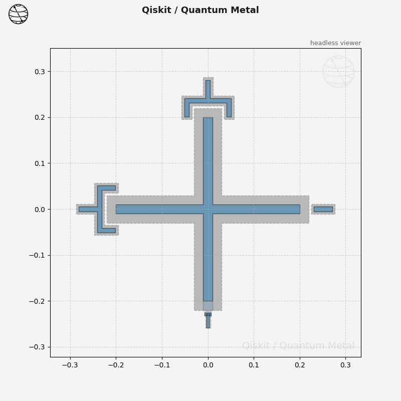
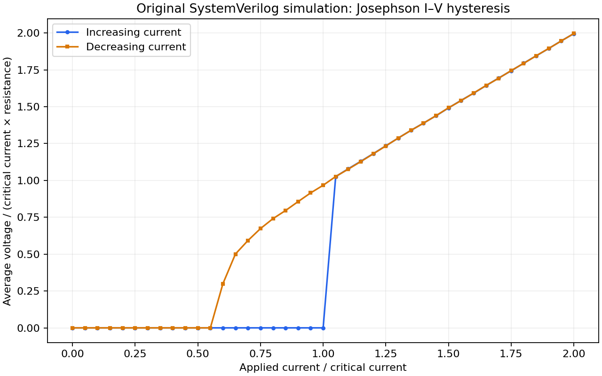

# Superconducting Qubits: From Circuit Models to Layout and Digital Emulation

An EC3104 Engineering Electromagnetics group project exploring how Josephson-junction circuits, quantum oscillators and microwave transmission lines connect to superconducting-qubit design.

Our work combines **qubit simulations, quantum light-matter interaction, microwave analysis, chip layout and SystemVerilog emulation**. Each part studies a different layer of the same circuit-design problem: how physical parameters and geometry shape energy levels, coupling, signal propagation and nonlinear dynamics.

## Project map

| Area | Work in this repository | Course and project relevance |
|---|---|---|
| Fixed transmon | Hamiltonian diagonalization, energy levels, wavefunctions, charge sensitivity, electrostatic examples | Links capacitance and Josephson inductance to an anharmonic quantum circuit |
| Tunable transmon | Flux-dependent spectrum, wavefunctions, operator matrix elements and noise-model calculations | Shows how magnetic flux controls circuit energy and transition frequencies |
| Fluxonium | Effective single-mode spectrum, potentials, wavefunctions, matrix elements and cutoff study | Explores the role of a large inductance alongside charging and Josephson energies |
| 0-pi qubit | Two-coordinate potential, eigenstates and flux dependence | Extends circuit quantization to coupled phase coordinates |
| Quantized antenna / receiver | Qubit-resonator exchange, dissipation, detuning response and coupling estimates | Connects electric-field quantization and dipole coupling to microwave reception |
| Quantized transmission line | Distributed LC modes, dressed states, avoided crossing and Rabi dynamics | Connects transmission-line theory to harmonic modes and circuit quantum electrodynamics |
| Xmon layouts | Five-Xmon processor geometry and a separate single-Xmon flux-line design | Translates circuit concepts into planar structures, readout routing and control lines |
| Josephson Verilog model | Fixed-point RCSJ dynamics, I-V hysteresis simulation and a Nexys 4 DDR interface design | Connects nonlinear circuit equations to numerical updates and digital hardware interfaces |

## 1. Superconducting-qubit models

### Fixed-frequency transmon

**Notebook:** [transmon_qubit.ipynb](transmon_qubit.ipynb)

We study the charge-basis Hamiltonian

$$H=4E_C(\hat n-n_g)^2-E_J\cos\hat\varphi,$$

with $[\hat\varphi,\hat n]=i$. The Josephson cosine gives unequal energy spacings, allowing the lowest states to form a qubit. The notebook includes spectrum calculations, charge-basis probabilities, cutoff checks, offset-charge dispersion and a Josephson-energy sweep.

For the example $E_J/h=15$ GHz and $E_C/h=0.30$ GHz, the saved results give:

- Transition frequency $f_{01}=5.682576$ GHz.
- Anharmonicity $\alpha=f_{12}-f_{01}\approx-344.77$ MHz.
- Agreement between scqubits and an independently assembled charge-basis Hamiltonian.

The electrostatics section connects potential, electric field, stored energy and capacitance per unit depth. A synthetic two-pad capacitance example then demonstrates the bridge from an effective capacitance to $E_C$ and the quantum spectrum.

### Flux-tunable transmon

**Notebook:** [tunable_transmon.ipynb](tunable_transmon.ipynb)

A split-junction circuit makes the effective Josephson energy flux dependent:

$$E_J(\Phi)=E_{J,\max}\sqrt{\cos^2(\pi\Phi/\Phi_0)+d^2\sin^2(\pi\Phi/\Phi_0)}.$$

The notebook uses $E_{J,\max}/h=50$ GHz, $E_C/h=0.25$ GHz and asymmetry $d=0.05$. It explores the spectrum versus flux, charge- and phase-basis wavefunctions, operator matrices and transition matrix elements. Coherence calculations illustrate the response to the noise assumptions selected in the notebook.

**Relevance:** magnetic-flux control connects the SQUID circuit to a tunable microwave transition and provides a direct link between field control, circuit parameters and quantum behavior.

### Fluxonium

**Notebook and script:** [fluxonium_qubit.ipynb](fluxonium_qubit.ipynb) · [fluxonium_qubit.py](fluxonium_qubit.py)

Fluxonium combines charging, Josephson and inductive energies. In the phase convention used by the implementation,

$$H=4E_C\hat n^2+\frac{1}{2}E_L\hat\varphi^2-E_J\cos\left(\hat\varphi+2\pi\frac{\Phi_{\mathrm{ext}}}{\Phi_0}\right).$$

The reference inputs are $E_J/h=8.9$ GHz, $E_C/h=2.5$ GHz, $E_L/h=0.5$ GHz and oscillator-basis cutoff 110. The work includes potentials at zero and half flux, phase-basis wavefunctions, a spectrum over one flux quantum, charge/phase operators and a cutoff study. The reference bias $0.33\Phi_0$ is separate from those sweep and comparison settings.

**Relevance:** this effective single-mode model shows how an inductive energy changes the potential landscape and the relationship between flux bias and transition energies.

### 0-pi qubit

**Notebook:** [zero_pi_qubit (1).ipynb](zero_pi_qubit%20%281%29.ipynb)

The 0-pi study uses two phase coordinates, $\theta$ and $\varphi$, to describe its potential and quantum states. It calculates low-energy eigenstates, plots the two-dimensional potential and wavefunctions, and follows the lowest transition as external flux changes.

**Relevance:** comparing this two-coordinate model with the transmon and fluxonium shows how circuit topology determines the degrees of freedom used in quantization.

## 2. Quantum antennas and transmission lines

### Quantized antenna / receiver model

**Notebook:** [quantized_antenna.ipynb](quantized_antenna.ipynb)

A transmon is coupled to a quantized resonator using a Jaynes-Cummings interaction,

$$H_{\mathrm{int}}=\hbar g\left(\hat\sigma_+\hat a+\hat\sigma_-\hat a^\dagger\right).$$

The simulations follow qubit excitation and resonator photon number during coherent exchange, compare ideal and dissipative evolution, and examine frequency selectivity through detuning. Charge matrix elements and the resonator's zero-point voltage provide a circuit-based coupling estimate.

**Relevance:** this connects the quantized electric field and energy absorption to a microwave circuit, complementing the classical antenna and oscillator picture.

### Quantized transmission line

**Notebook:** [quantum_transmission_line (2).ipynb](quantum_transmission_line%20%282%29.ipynb)

Starting from distributed inductance $L'$ and capacitance $C'$, the notebook calculates

$$Z_0=\sqrt{L'/C'},\qquad v_p=\frac{1}{\sqrt{L'C'}},\qquad f_n=\frac{(2n+1)v_p}{4\ell}$$

for the quarter-wave resonator boundary condition. The model then connects these modes to oscillator energy levels, bare and dressed qubit-resonator states, avoided crossings, vacuum Rabi oscillations and dispersive-shift estimates.

**Relevance:** the transmission line becomes a collection of quantum harmonic modes, joining distributed circuit theory to the resonators used for superconducting-qubit coupling and readout.

## 3. Xmon geometry and microwave analysis

### Five-Xmon processor layout

**Notebook:** [XMON_processor.ipynb](XMON_processor.ipynb)

The Quantum Metal design places five Xmon components on a 6 mm by 6 mm chip area, with staggered meander readout resonators, feedline couplers, launchpads and XY/flux control routing. An export cell writes the processor geometry as GDSII.

The accompanying analytical/quasi-TEM examples estimate CPW impedance, phase velocity, per-unit-length parameters and quarter-wave resonance frequencies. A transmission-line reflection calculation illustrates the effect of load mismatch. These calculations use the example dimensions and assumptions stated in their cells.

### Single-Xmon flux-line layout

**Folder:** [xmon_transmon_fluxlines/](xmon_transmon_fluxlines/)

This separate executed tutorial builds one cross-shaped transmon with two claw connectors, one gap connector and a south flux line. It includes the notebook, a PNG and the committed [xmon_fluxline.gds](xmon_transmon_fluxlines/xmon_fluxline.gds).



*Single-Xmon geometry from the executed notebook. The five-Xmon processor is a separate design.*

**Relevance:** the layouts connect lumped circuit elements to planar microwave structures. Together with the electrostatic and CPW studies, they show how geometry, capacitance, routing and transmission-line behavior enter the design workflow.

## 4. Josephson-junction SystemVerilog model

**Project folder:** [Nexys4DDR_Josephson_Unmodified/](Nexys4DDR_Josephson_Unmodified/)

The resistively and capacitively shunted junction (RCSJ) model relates current, voltage and junction phase:

$$I=I_c\sin\varphi+\frac{V}{R}+C\frac{dV}{dt},\qquad V=\frac{\Phi_0}{2\pi}\frac{d\varphi}{dt}.$$

The SystemVerilog implementation uses fixed-point state updates and a sine lookup table to emulate these classical nonlinear dynamics. The supplied testbench sweeps the bias current upward and downward and records the mean voltage.

### Simulation result

The supplied simulator log and CSV contain **82 I-V measurement points** and show hysteresis. At normalized current $I/I_c=0.80$, the upward-sweep mean voltage is approximately zero and the downward-sweep mean is approximately 0.74094.



*Supplied SystemVerilog simulation in normalized current and voltage units.*

### Board-interface design

The Nexys 4 DDR source project adds a clocked top level, switch-controlled bias and run/pause behavior, LEDs, a multiplexed display interface, pin/clock constraints and Vivado scripts. The board-UI verification assets cover reset, input scaling, state progression, pause and display-page behavior. The hardware target is `xc7a100tcsg324-1`.

```text
Nexys4DDR_Josephson_Unmodified/
├── original/       # RCSJ core and current-sweep testbench
├── board/          # Nexys top level and UI adapter
├── constraints/    # Pin and clock assignments
├── scripts/        # Vivado project, simulation and build commands
├── verification/   # Testbenches, supplied log, CSV and source hashes
└── docs/           # Model explanation and supplied I-V plot
```

**Relevance:** the digital model turns Josephson circuit equations into discrete-time computation. The I-V sweep and board interface complement the quantum notebooks by studying junction dynamics and their digital representation. The results shown here are simulation evidence; the Nexys files are the board-targeted interface and build design.

## Getting started

### Clone the repository

```bash
git clone https://github.com/rishitbagda/Superconducting-Qubits-Simulations.git
cd Superconducting-Qubits-Simulations
```

### Python notebooks

Use a Python environment with JupyterLab, NumPy, SciPy, Matplotlib, scqubits, QuTiP and IPython:

```bash
python -m venv .venv
# Linux / macOS
source .venv/bin/activate
# Windows PowerShell: .venv\Scripts\Activate.ps1

python -m pip install --upgrade pip
python -m pip install jupyterlab numpy scipy matplotlib ipython matplotlib-inline scqubits==4.3.1 qutip
python -m jupyter lab
```

The fixed-transmon notebook records scqubits 4.3.1. Open the required notebook and follow its cells and parameter definitions in order; the notebooks also contain saved outputs for inspection. The studies use different model parameters, so interpret results within their own notebook rather than as one shared device calibration.

For layout work, the executed single-Xmon notebook records Python 3.10 and Quantum Metal 0.9.0. Install the layout package in a separate environment if needed:

```bash
python -m pip install quantum-metal==0.9.0
```

The package is imported as `qiskit_metal`. The layout notebooks use inline/headless viewing through `qm.gui(design)` or `qm.view(design)`.

### Fluxonium command-line analysis

From the repository root:

```bash
python fluxonium_qubit.py --output-dir results/fluxonium --no-show
```

This saves plots, CSV tables and a summary in the chosen output directory. Running the notebook from the repository root also lets it import the accompanying Python module.

### Verilog simulation

With Icarus Verilog installed and `iverilog` / `vvp` on `PATH`:

```bash
cd Nexys4DDR_Josephson_Unmodified
iverilog -g2012 -s tb_jj -o tb_jj.vvp original/jj_rcsj.sv original/tb_jj.sv
vvp tb_jj.vvp
```

These commands run the extracted model and testbench directly. The included simulation log and CSV preserve the supplied 82-point result.

### Vivado project workflow

From a Vivado command prompt in `Nexys4DDR_Josephson_Unmodified/`:

```text
vivado -mode batch -source scripts/create_project.tcl
vivado -mode batch -source scripts/build_bitstream.tcl
```

The supplied scripts define project creation, simulation and the synthesis/implementation flow. See the [Verilog project guide](Nexys4DDR_Josephson_Unmodified/README.md) and [equations and code walkthrough](Nexys4DDR_Josephson_Unmodified/docs/EXPLANATION.md) for the interface and detailed instructions.

## Reading the results

- **Quantum studies:** eigenenergies, wavefunctions, operator matrices and dynamical simulations for the stated circuit models.
- **Electromagnetics:** illustrative electrostatic calculations and analytical transmission-line/CPW models.
- **Layout studies:** planar geometry, routing and GDS exports.
- **Digital study:** classical RCSJ simulation and board-interface design.

In the scqubits calculations, energy parameters are generally expressed as **E/h in GHz**, while external flux is given in units of $\Phi_0=h/(2e)$. The Verilog I-V data uses normalized units. Numerical predictions, geometric layouts and simulation traces are identified by their respective models throughout the project.

## Suggested reading order

1. Fixed transmon: circuit quantization and the capacitance-to-spectrum connection.
2. Tunable transmon, fluxonium and 0-pi: compare circuit topology and flux response.
3. Quantized antenna and transmission line: connect modes, coupling and readout.
4. Xmon notebooks: follow the move from circuit models to microwave geometry.
5. Josephson Verilog project: explore nonlinear junction dynamics and digital implementation.

Each part contributes to the full picture: **fields and geometry define circuit parameters; circuit parameters define Hamiltonians and dynamics; simulation and layout make those relationships visible.**
